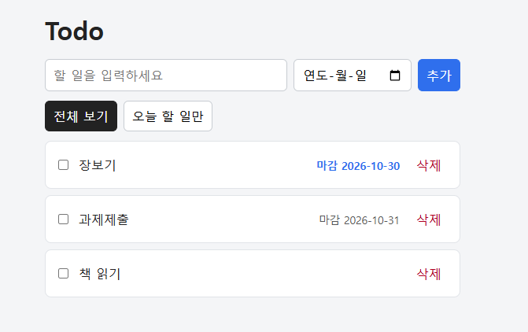
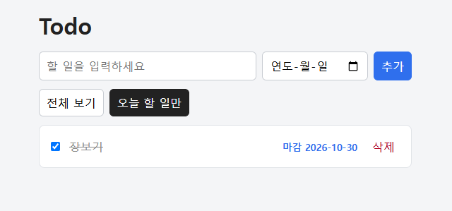
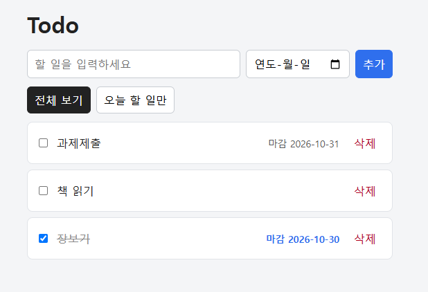
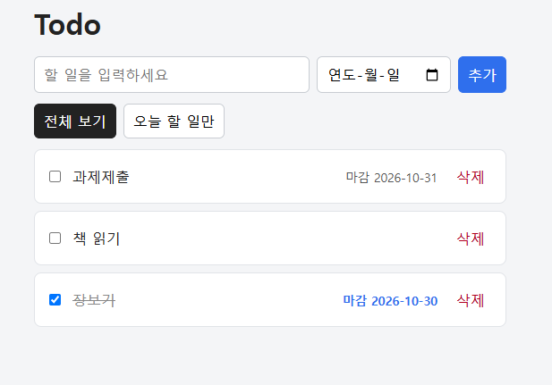
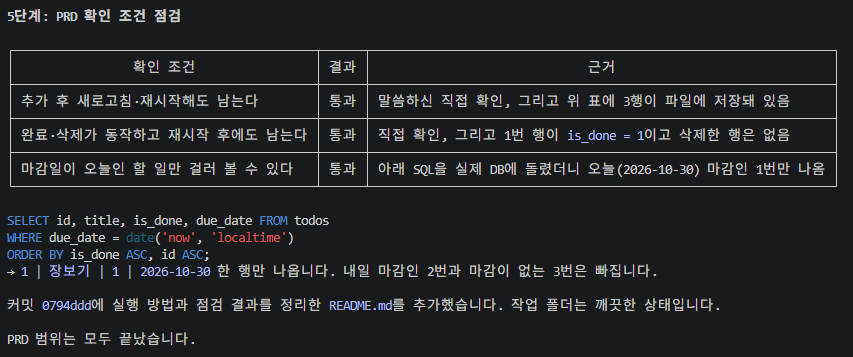
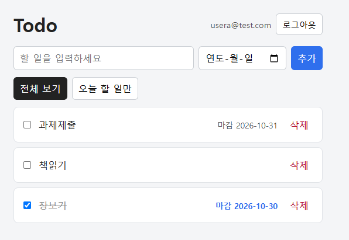
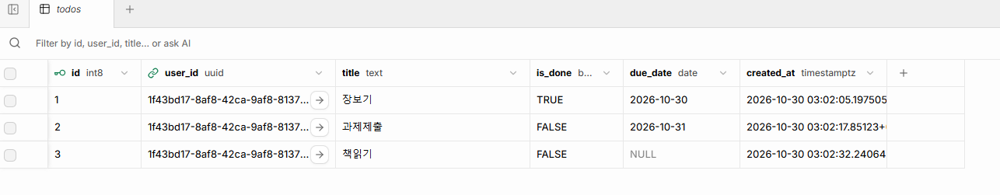
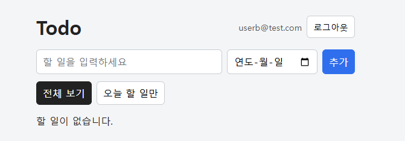
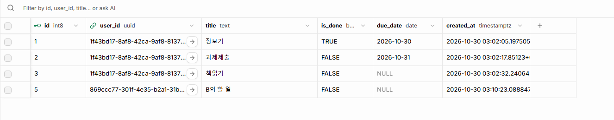
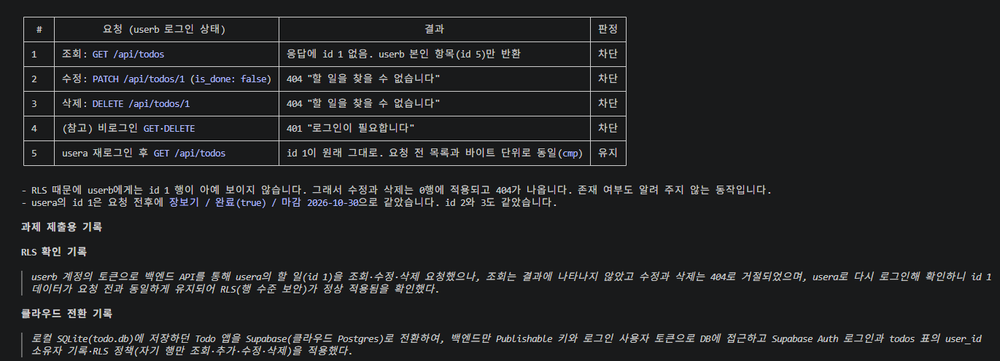

# Todo 앱 과제 제출

## 1. 과제 개요
같은 Todo(할 일) 앱을 두 가지 방식으로 만들고 확인했다.

| | 저장소 | 로그인 | 브랜치/태그 |
|---|---|---|---|
| **길 A** | 내 컴퓨터의 SQLite 파일(`todo.db`) | 없음 | 태그 `path-a` |
| **길 B** | Supabase(무료 클라우드 Postgres) | Supabase Auth, 사용자별 RLS | `main` |

공통 기능: 할 일 추가 / 목록 / 완료 표시 / 삭제, **마감일(선택) 표시**, **오늘 할 일만 보기**.
구조: 화면(`public/`)은 백엔드 API에만 요청하고, DB 접근과 접속 키는 백엔드(`server/`)에만 있다.

관련 문서
- [PRD.md](PRD.md) — 요구사항
- [DB-설계.md](DB-설계.md) — DB 구조(길 A 기준 SQLite 설계)
- [배포-준비물.md](배포-준비물.md) — Render 배포 준비물
- [supabase/schema.sql](supabase/schema.sql) — 길 B의 표와 RLS 정책

---

## 2. 길 A (로컬 SQLite) 확인 결과
`git checkout path-a` 로 볼 수 있다. Node.js 24 내장 `node:sqlite`를 써서 C++ 빌드 도구가 필요 없다.

### 01. 할 일 추가와 마감일 표시
마감일을 넣어 추가하면 목록에 마감일이 보인다(오늘 마감은 파란색). 마감일이 없는 항목은 표시가 없다.



### 02. 오늘 할 일만 보기
"오늘 할 일만" 버튼을 누르면 마감일이 오늘(2026-10-30)인 항목만 남는다.



### 03. 재시작 전
완료 표시한 "장보기"는 목록 아래로 내려가 취소선과 체크가 표시된다.



### 04. 재시작 후
서버를 껐다 켠 뒤에도 같은 항목, 같은 완료 상태가 남아 있다.



### 05. PRD 확인 조건 점검
`todo.db`를 직접 조회한 결과로 PRD의 확인 조건 3가지를 모두 통과했다.



| PRD 확인 조건 | 결과 |
|---|---|
| 추가 후 새로고침·재시작해도 남는다 | 통과 |
| 완료·삭제가 동작하고 재시작 후에도 남는다 | 통과 |
| 마감일이 오늘인 할 일만 걸러 볼 수 있다 | 통과 |

---

## 3. 길 B (Supabase) 확인 결과
저장소만 Supabase로 바꾸고 기능은 그대로 유지했다. 로그인은 Supabase Auth, 할 일마다 `user_id`(소유 사용자)를 기록하고, RLS 정책으로 로그인한 사용자가 **자기 행만** 조회·추가·수정·삭제할 수 있다.
백엔드는 service_role(Secret) 키를 쓰지 않고, Publishable 키와 로그인한 사용자의 토큰으로 요청해서 RLS가 실제로 적용된다.

### 06. usera 로그인 후 할 일
usera@test.com으로 로그인하면 usera의 할 일 3개가 보인다.



### 07. Supabase 표(DB)에 저장된 데이터
`todos` 표에 데이터가 저장되어 있고, 각 행에 소유 사용자 `user_id`가 기록되어 있다.



### 08. userb 로그인 — 빈 목록
userb@test.com으로 로그인하면 usera의 할 일이 하나도 보이지 않는다.



### 09. 한 표에 두 사용자의 데이터
같은 `todos` 표에 usera(id 1~3)와 userb(id 5)의 행이 `user_id`가 서로 다르게 저장되어 있다. 그런데도 화면에서는 각자 자기 것만 보인다.



### 10. 다른 사용자의 할 일 수정·삭제 차단
userb의 토큰으로 usera의 할 일(id 1)을 조회·수정·삭제 요청한 결과 모두 거절되었고, usera로 다시 로그인해 보니 id 1은 요청 전과 동일했다.



| # | 요청 (userb 로그인 상태) | 결과 | 판정 |
|---|---|---|---|
| 1 | `GET /api/todos` | 응답에 id 1 없음 | 차단 |
| 2 | `PATCH /api/todos/1` | 404 | 차단 |
| 3 | `DELETE /api/todos/1` | 404 | 차단 |
| 4 | (참고) 비로그인 `GET`·`DELETE` | 401 | 차단 |
| 5 | usera 재로그인 후 `GET` | id 1 원래 그대로(요청 전 목록과 동일) | 유지 |

---

## 4. 제출용 기록 (한 줄)

**RLS 확인 기록**
> userb 계정의 토큰으로 백엔드 API를 통해 usera의 할 일(id 1)을 조회·수정·삭제 요청했으나, 조회는 결과에 나타나지 않았고 수정과 삭제는 404로 거절되었으며, usera로 다시 로그인해 확인하니 id 1 데이터가 요청 전과 동일하게 유지되어 RLS(행 수준 보안)가 정상 적용됨을 확인했다.

**클라우드 전환 기록**
> 로컬 SQLite(todo.db)에 저장하던 Todo 앱을 Supabase(클라우드 Postgres)로 전환하여, 백엔드만 Publishable 키와 로그인 사용자 토큰으로 DB에 접근하고 Supabase Auth 로그인과 todos 표의 user_id 소유자 기록·RLS 정책(자기 행만 조회·추가·수정·삭제)을 적용했다.

---

## 5. 실행 방법
필요한 것: Node.js 24 이상, Supabase 무료 프로젝트.

### 길 B (현재 `main`)
1. 패키지 설치
   ```
   npm install
   ```
2. Supabase 프로젝트에서 SQL Editor를 열고 [supabase/schema.sql](supabase/schema.sql) 전체를 붙여 넣어 실행한다(표와 RLS 정책 생성).
3. `.env.example`을 복사해 `.env`를 만들고 Supabase 대시보드 > Project Settings > API 의 값을 넣는다. **`.env`는 커밋되지 않는다.**
   ```
   SUPABASE_URL=...
   SUPABASE_PUBLISHABLE_KEY=...
   ```
4. 서버 실행
   ```
   npm start
   ```
5. 브라우저에서 http://localhost:4321 을 열고 회원가입 후 로그인한다.
   (Supabase에서 "Confirm email"이 켜져 있으면 확인 메일의 링크를 먼저 눌러야 한다.)

### 길 A (로컬 SQLite)
```
git checkout path-a
npm install
copy .env.example .env
npm start
```
http://localhost:4321 에서 열린다. 데이터는 `todo.db`에 저장된다.

### 보안 메모
- `.env`, `todo.db`, `node_modules`는 `.gitignore`에 있어 저장소에 올라가지 않는다.
- 접속 키는 `.env`(백엔드)에만 있고, 화면 코드(`public/`)에는 없다.
- 로그인 토큰은 `HttpOnly` 쿠키에만 있어 화면 JS가 읽을 수 없다.
